<div align="center">


# Mandao

**Spec-Driven Development for AI coding agents. Any harness.**

*mandao* · Cali slang for an errand you send someone to run — and expect done right.

[](LICENSE)
[](https://github.com/JuanGuzman-io/mandao/actions/workflows/ci.yml)
<!-- After the first publish:
[](https://www.npmjs.com/package/mandao)
[](https://www.npmjs.com/package/mandao)
-->

> **Beta.** Mandao is in public beta: the core flow is stable and tested on real specs; some commands are still planned. Feedback welcome.

[Quick start](#quick-start) · [How it works](#how-it-works) · [Choose your path](#choose-your-path) · [Harnesses](#harnesses) · [Commands](#commands) · [Docs](#docs)

</div>

---

## Why Mandao

AI agents write code fast. They also guess, skip tests, and say "done" when it isn't. Mandao gives every piece of work a clear errand — a spec — and doesn't sign off until there's a receipt.

- **Specs your PO can read.** Stories with acceptance criteria, traced to requirements, tasks, tests and commits. Every spec folder follows one fixed layout per depth: see [spec anatomy](docs/spec-anatomy.md).
- **A reviewer that isn't the author.** Every task is reviewed by a separate agent in a clean context — a different model or a different harness when one is available, and the record says when it isn't.
- **Tests before code (TDD).** Write a failing test from the spec, make it pass, then refactor. Mandao requires recorded red evidence before implementation where TDD applies: the test demonstrates the missing behavior before the code addresses it, keeping implementation tied to the spec. [TDD in the task flow](#test-driven-development-tdd).
- **One flow, any harness.** Claude Code, Codex, OpenCode, Copilot. Out of tokens mid-spec? Switch tools and run `/mandao-resume`.
- **Safer skill installs.** Catalog skill repositories require HTTPS; Git preserves your `GIT_SSH_COMMAND` and adds non-interactive mode only when no `BatchMode` setting is present.
- **Kaizen after every spec.** `close` measures rework, review failures, cost and session timing. Script-stamped events separate active time from human and agent waits; historical costs show a corrected view without editing their source logs. Kaizen names up to three evidence-backed causes and proposes fixes; nothing changes until you approve it. For layout v2, lessons stay in the spec's `close-summary.md`; older specs keep [`docs/kaizen/`](docs/kaizen/).

## How it works

<picture>
  <source media="(prefers-color-scheme: dark)" srcset="docs/diagrams/overview-dark.svg">
  
</picture>

<sub>Green: agent commands (a model session) · red: you approve · orange: `mandao` scripts, no tokens. Every diagram is generated from the commands themselves (`npm run diagrams`).</sub>

```
constitution → story → specify → [clarify] → tasks → implement → verify → close
```

1. **Constitution** — once per project. Maps the code, writes the technical rules and the product context, and picks the right skills for your stack.
2. **Spec** — a story becomes requirements, a design (with a diagram you approve) and small tasks.
3. **Implement** — a Leader hands each task to an Implementer; a Reviewer checks it; one commit per approved task. Never a push.
4. **Close** — after `verify` checks every acceptance criterion, `close` writes release notes and feeds what was learned back into the constitution.

Every spec works in its own git worktree, so your main checkout stays clean.

### Test-driven development (TDD)

TDD means writing a test for the expected behavior **before implementing it**. In `/mandao-implement`, tasks that require tests follow **RED → GREEN → REFACTOR**:

1. **RED:** derive tests from the spec's scenarios and confirm they fail for the expected reason. For tasks with risk tags or tier `strong`, a separate **Tester** writes them; otherwise, the **Implementer** does.
2. **GREEN:** the Implementer writes the minimum code that makes those tests pass.
3. **REFACTOR:** improve the code within the task's scope while keeping the tests green. Gates and an independent Reviewer check the result before a local commit.

**Why we use it:** tests written after the code can simply repeat its assumptions. Starting from the spec and seeing the tests fail first gives evidence that they can detect the missing behavior or reproduce the bug, before the implementation makes them pass.

This is enforced in the execution flow: `mandao run red` records a `RED` row only after a failing run, and the loop withholds implementation until that evidence exists. Tests added during rework need red evidence too; changes to a red test are flagged for review.

TDD applies where the test policy requires it. Documentation-only tasks need no red test. **Characterization tasks**, which protect existing behavior, use mutation evidence instead: their tests must catch a deliberate change to the behavior they protect.

See the [test policy](core/templates/shared/rules/test-policy.md#tdd-where-tests-are-mandatory-adr-0022) and [TDD decision](docs/decisions/0022-tdd-discipline-and-spec-diagrams.md).

<details>
<summary><b>A spec's status, and how a task runs</b></summary>

<picture>
  <source media="(prefers-color-scheme: dark)" srcset="docs/diagrams/lifecycle-dark.svg">
  
</picture>

<picture>
  <source media="(prefers-color-scheme: dark)" srcset="docs/diagrams/task-loop-dark.svg">
  
</picture>

</details>

---

## Quick start

**Requirements:** Node ≥ 22.18 · git · at least one [supported harness](#harnesses) · [Archify](https://github.com/tt-a1i/archify) required for diagrams and offered as a pinned install during interactive init (Mermaid only when explicitly configured with `diagrams.engine: mermaid`) · [Graphify](https://github.com/Graphify-Labs/graphify) recommended (without it, repository mapping falls back to plain search, with lower confidence).

<picture>
  <source media="(prefers-color-scheme: dark)" srcset="docs/diagrams/install-dark.svg">
  
</picture>

### Start a new project

```bash
npx mandao@beta init my-project --harness claude,codex
cd my-project
```
`init my-project` creates the folder and runs `git init` when needed. Then, in your agent: `/mandao-constitution` — in a new project it asks what you're building and helps you decide the stack.

### Add Mandao to an existing project

```bash
cd my-repo
npx mandao@beta init
```
`init` detects single repo, monorepo or polyrepo and asks which harnesses you use. Then run `/mandao-constitution`: it reads your code and writes everything as **draft** until you approve it.

### Join a team that already uses Mandao

```bash
git clone <repo> && cd <repo>
npx mandao@beta sync      # regenerates the harness files from the team's .mandao/config.yml
npx mandao@beta doctor    # checks everything is ready
```
Your harness isn't in the team's config yet? `mandao harness add <id>`.

### Make `/mandao-init` available in every repo

```bash
npx mandao@beta init --scope global --harness claude,codex
```

### Add a harness, update, check

```bash
mandao harness add opencode
mandao update
mandao doctor
```

<details>
<summary><b>Monorepo or polyrepo?</b></summary>

- **Monorepo:** `init` registers each app or package as a project. One constitution for the workspace, one per project for what differs.
- **Polyrepo** (a folder with several independent repos): `init` offers to turn the root into a workspace repo, so specs that touch several repos are versioned in one place. Each repo gets its own slice of the spec (`specs/<ID>/spec-ref.md`).

</details>

<details>
<summary><b>Trying it on a team repo without changing it?</b></summary>

`npx mandao@beta init --shadow` keeps every generated file out of git (via `.git/info/exclude`). Only your code reaches the repo, through normal PRs.

</details>

<sub>Prefer another runner? `pnpm dlx mandao@beta …` and `bunx mandao@beta …` work too.</sub>

### The recommended flow

```bash
mandao start "add a remember-me option to login"   # branch + worktree + setup, no model tokens
```

1. Open your agent **inside the worktree** (`mandao start` prints the exact command; `--open` launches it).
2. Run `/mandao-specify` — at lite depth, one session writes the story, the spec and the tasks.
3. Approve from the terminal: `mandao approve <ID> spec` — no model session, no tokens. It prints the command for the next step.
4. In a **new** session, from the worktree: `/mandao-implement`, then `/mandao-verify` and `/mandao-close`. A fresh session costs less than re-reading the whole specify context on every turn ([ADR 0038](docs/decisions/0038-session-cut-at-task-boundaries.md)).

Started from the main checkout by mistake? Mandao creates the worktree anyway and tells you how to resume there.

## Your first mandao in 5 minutes

```bash
mandao start --quick "fix the label on the checkout button"
```

Then, in your agent inside the worktree: `/mandao-quick`.

What you'll see:

1. A **gate check**: is this really small? (one module, no contracts or public interfaces, no risky areas such as auth, payments or migrations). If not, Mandao suggests a spec instead.
2. The change, lint and the impacted tests — never the whole suite on your laptop.
3. An **independent review**.
4. One commit, in the team's format. No push.

```
🐛 fix(web): correct checkout button label

Mandao-Quick: checkout-label
```

---

## Choose your path

✅ required · ⚙️ triggers on its own · ➕ optional

| You want to… | Path |
|---|---|
| **Set up a project** | `init` ✅ → `constitution` ✅ → `constitution --product` ➕ |
| **Build a story** | `story` ➕ → `specify` ✅ → `clarify` ⚙️ → `tasks` ✅ → `implement` ✅ → `verify` ✅ → `close` ✅ |
| **Break down an epic** | `story` ✅ → `specify` proposes the stories → each one follows its own path |
| **Fix a bug** | `specify` ✅ (lite: spec and tasks in one session, regression test red first) → `implement` → `verify` → `close` |
| **Ship a hotfix** | `specify --hotfix` ✅ → … → `close` (reminds you to back-merge) |
| **Make a small change** | `quick` ✅ — escalates to a spec if it grows |
| **Pick up where you left off** | `resume` — in any harness |

At lite depth `specify` writes the tasks itself; `tasks` is a separate step at standard and full depth.

Each path has its own diagram in [docs/process-map.md](docs/process-map.md).

## Harnesses

| Harness | Status |
|---|---|
| Claude Code | 🟢 live-tested |
| Codex (OpenAI) | 🟢 live-tested |
| OpenCode 2.x (2.1.1+) | 🟢 live-tested in the TUI · non-interactive use pending |
| GitHub Copilot (VS Code) | 🟡 snapshot-tested |
| Antigravity (Google) | 🧪 experimental · not live-tested |
| Any other agent | ⚪ via `AGENTS.md` |

`mandao doctor` checks supported versions. Where files go for each harness: [docs/harnesses.md](docs/harnesses.md).

**Models are your call.** `init` asks one question — a profile: `peak` (best per role, default), `balanced` or `economy` — and shows the resulting models per harness for you to accept or tweak. Mandao recommends from each vendor's docs, dated, and **never changes a model without you**.

**Cost, in the open.** Every spec records its cost per command and per role. On a subscription these are list-price equivalents, not billed money. There's no budget cap by default; set `budget.per_spec` if you want one. How it is measured: [docs/cli.md](docs/cli.md#cost).

## Commands

| Command | What it does | Status |
|---|---|---|
| [`constitution`](docs/commands/constitution.md) | Project foundation: rules, product context, AGENTS.md, skills | 🟢 stable |
| [`story`](docs/commands/story.md) | A story with enough context, from your tracker or from scratch | 🟢 stable |
| [`specify`](docs/commands/specify.md) | Requirements, design, data model and diagram for approval (lite: one `spec.md`) | 🟢 stable |
| [`clarify`](docs/commands/clarify.md) | Resolve open questions and conflicts (asks the PO when needed) | 🟢 stable |
| [`tasks`](docs/commands/tasks.md) | Small, traceable tasks with test levels declared | 🟢 stable |
| [`implement`](docs/commands/implement.md) | Leader → Implementer → Reviewer, red tests first, one commit per task | 🟢 stable |
| [`verify`](docs/commands/verify.md) | Impacted tests, e2e on critical flows, AC traceability | 🟢 stable |
| [`close`](docs/commands/close.md) | Release notes, diagram drift, Kaizen, publish to your tracker | 🟢 stable |
| [`quick`](docs/commands/quick.md) | Small changes behind a gate | 🟢 stable |
| [`resume`](docs/commands/resume.md) | Continue a spec from its checkpoint, in any harness | 🟢 stable |
| [`init`](docs/commands/init.md) | Set up Mandao in a repo from inside your agent (after `init --scope global`) | 🟢 stable |
| [`research`](docs/commands/research.md) | Sourced research for technical decisions | ⚪ planned |
| [`perf`](docs/commands/perf.md) | Measured performance work: before and after, every time | ⚪ planned |
| [`audit`](docs/commands/audit.md) | Project health by lens: drift, security, quality… | ⚪ planned |

### Why Mandao keeps review fast and structured

The Reviewer gets the canonical changed-file diff. Verified generated harness copies and diagram SVGs
arrive as hash-and-origin receipts; unverified files stay visible in full. Each task brief can link only
the design decisions it needs, with their rationale and rejected alternatives, and carries an AC/scenario
clause checklist. Reviewer findings use a validated JSON format with explicit `open`/`resolved` status
and severity, so the security gate blocks only open high or critical security findings. This reduces
repeated context while keeping TDD, deterministic gates and the independent Reviewer in place. See
[ADR 0045](docs/decisions/0045-structured-review-context.md).

Designs also carry a deterministic principles gate: the Reviewer enforces only approved principles
marked applicable, while data writes require declared ACID handling and a task-level partial-failure
test. Existing constitutions are never rewritten automatically; `doctor` reports when principles are
not yet declared. See [ADR 0047](docs/decisions/0047-gated-design-principles-and-data-write-validation.md).

From the terminal, no model needed: `mandao start`, `mandao approve`, `mandao doctor`, `mandao models`.

CLI reference (`init`, `sync`, `doctor`, `models`, `skills`, `run`…): [docs/cli.md](docs/cli.md).

---

## Docs

- [Design document](MANDAO-DESIGN.md) — the source of truth
- [Backlog and implementation phases](docs/backlog.md) · [Latency diagnosis](docs/audits/2026-10-latency.md)
- [CLI reference](docs/cli.md) · [Harnesses](docs/harnesses.md)
- [Process map](docs/process-map.md) · [Commands, one page each](docs/commands/)
- [Customizing with overrides](docs/customizing.md)
- [Command format](docs/command-format.md) · [Schemas](docs/schemas.md) · [Decisions](docs/decisions/)

## Contributing

```bash
npm ci
npm run lint
npm run typecheck
npx --no-install vitest related --run --maxWorkers=2 path/to/changed-file.ts
npm run build
node dist/cli.js --help
```

Use the files changed against the PR base as inputs to `vitest related`; also run any tests that read
changed documentation or fixtures by path. Documentation-only changes may have no related tests.
The full suite runs in PR CI; do not run `npm run check` locally because it includes the full suite.
Use the checkout's local build for development. See [CONTRIBUTING.md](CONTRIBUTING.md) for commits, releases and trusted publishing.

## Roadmap

The accepted improvement program covers security, measurement, smaller review context, fewer repeated
gates and pauses, delivery, research and parallel tasks. See the [single backlog](docs/backlog.md) for
phase status, dependencies and acceptance criteria. Each phase starts with an approved plan and ships
in its own PR after CI passes. TDD, independent review and gates remain required.

Work types beyond apps and AI (ML, infrastructure, DevOps and security) remain a separate proposed
design in [ADR 0031](docs/decisions/0031-work-types.md).

## Acknowledgments

Mandao stands on ideas from [GitHub Spec Kit](https://github.com/github/spec-kit) and [AKILI-SPECS](https://github.com/JuankCadavid/akili-specs).

## License

[MIT](LICENSE) © Juan David Delgado Guzmán
