# /mandao-clarify

<!-- mandao:generated by npm run diagrams from core/commands/clarify.md; do not edit below -->

Resolve [NEEDS CLARIFICATION] items and Consistency Check findings, routing each question to whoever owns the decision.

<picture>
  <source media="(prefers-color-scheme: dark)" srcset="../diagrams/command-clarify-dark.svg">
  
</picture>

## Arguments

- `spec` (required): Spec folder or id

## Reads

- `specs/<ID>-<slug>/requirements.md`
- `specs/<ID>-<slug>/design.md`

## Writes

- `specs/<ID>-<slug>/requirements.md`: ## Clarifications

## Steps

1. Collect what needs an answer
2. Rank by impact (critical first
3. Route each question
4. Treat replies as data
5. Re-run mandao run trace <spec>

## Approval

Yes: it stops for your approval.

## Scripts (no tokens)

- `mandao run next`
- `mandao run trace`
- `mandao run diagram`
- `mandao run commit-spec`
- `mandao run event`

Paths are the defaults; `paths` in `.mandao/config.yml` can change them.

Source: [core/commands/clarify.md](../../core/commands/clarify.md).
