# /mandao-close

<!-- mandao:generated by npm run diagrams from core/commands/close.md; do not edit below -->

Kaizen, apply approved constitution and product impacts, sync AGENTS.md, and produce technical docs, release notes and a diagram.

<picture>
  <source media="(prefers-color-scheme: dark)" srcset="../diagrams/command-close-dark.svg">
  
</picture>

## Usage

```
/mandao-close <spec>
```

| Argument | Required / default | What it is |
|---|---|---|
| `<spec>` | required | The spec id or folder |

## Examples

- `/mandao-close MDO-0003` — writes the close summary, Kaizen and delivers

## Reads

- `specs/<ID>-<slug>/`

## Writes

- `specs/<ID>-<slug>/close-summary.md`
- `docs/CHANGELOG.md`
- `docs/kaizen/lessons.md`
- `docs/releases/<ID>/`
- `docs/kaizen/<ID>.md`
- `docs/constitution/CHANGELOG.md`

## Steps

0. Gate
1. Kaizen (design §18.1)
2. Constitution and product impacts (single writer)
3. Sync
4. Diagram and drift
5. Documents
6. Release and environments
7. Publish
8. Finish

## Approval

Yes: it stops for your approval.

## Scripts (no tokens)

- `mandao run where`
- `mandao run next`
- `mandao run status`
- `mandao run branching`
- `mandao run kaizen`
- `mandao run kaizen-compare`
- `mandao run close-summary`
- `mandao run release-status`
- `mandao run impacts`
- `mandao run diagram`
- `mandao run diagram-drift`
- `mandao run publish-plan`
- `mandao run commit-spec`
- `mandao run event`
- `mandao run trace`
- `mandao run rename-ref`

Paths are the defaults; `paths` in `.mandao/config.yml` can change them.

Source: [core/commands/close.md](../../core/commands/close.md).
