# /mandao-constitution

<!-- mandao:generated by npm run diagrams from core/commands/constitution.md; do not edit below -->

Establish or update the project foundation (technical constitution and product context), the AGENTS.md hierarchy and the project skills.

<picture>
  <source media="(prefers-color-scheme: dark)" srcset="../diagrams/command-constitution-dark.svg">
  
</picture>

## Arguments

- `mode`: auto | new | legacy | active (default: auto-detect)
- `product`: Incorporate business sources from .mandao/sources.yml (or: ingest <source>)

## Reads

- `.mandao/config.yml`
- `.mandao/sources.yml`
- `docs/constitution/`

## Writes

- `docs/constitution/*.md`: workspace constitution and product context
- `<project>/docs/constitution/*.md`: project level
- `AGENTS.md`: root

## Steps

1. Read the workspace
2. Map the code
3. Technical constitution
4. Product context
5. AGENTS.md hierarchy
6. Skills
7. Clarify and approve (you approve)

## Approval

Yes: it stops for your approval.

## Scripts (no tokens)

- `mandao run fingerprint`
- `mandao run branching`
- `mandao run security-scanning`

Paths are the defaults; `paths` in `.mandao/config.yml` can change them.

Source: [core/commands/constitution.md](../../core/commands/constitution.md).
