# /mandao-implement

<!-- mandao:generated by npm run diagrams from core/commands/implement.md; do not edit below -->

Run the Leader → Implementer → Reviewer loop task by task, with checkpoints after every step and a commit after each Reviewer PASS.

<picture>
  <source media="(prefers-color-scheme: dark)" srcset="../diagrams/command-implement-dark.svg">
  
</picture>

## Arguments

- `spec` (required): Spec folder or id
- `task`: Optional task id (default: the next eligible task)

## Reads

- `specs/<ID>-<slug>/tasks.md`
- `specs/<ID>-<slug>/_log/progress.yml`

## Writes

- `(code)`: one local commit per task after PASS
- `specs/<ID>-<slug>/_log/execution.md`
- `specs/<ID>-<slug>/_log/progress.yml`
- `specs/<ID>-<slug>/tasks.md`

## Steps

0. Before the first task
1. For each task
2. After the last task

## Approval

No approval step of its own.

## Scripts (no tokens)

- `mandao run where`
- `mandao run next`
- `mandao run models`
- `mandao run status`
- `mandao run tasks`
- `mandao run step`
- `mandao run brief`
- `mandao run loop`
- `mandao run checkpoint`
- `mandao run resources`
- `mandao run gates`
- `mandao run review-pack`
- `mandao run review`
- `mandao run test-review`
- `mandao run commit`
- `mandao run pr-plan`
- `mandao run mutation`
- `mandao run implement-summary`
- `mandao run event`

Paths are the defaults; `paths` in `.mandao/config.yml` can change them.

Source: [core/commands/implement.md](../../core/commands/implement.md).
