# /mandao-init

<!-- mandao:generated by npm run diagrams from core/commands/init.md; do not edit below -->

Set up Mandao in the current workspace by running the Mandao CLI, then suggest the constitution.

<picture>
  <source media="(prefers-color-scheme: dark)" srcset="../diagrams/command-init-dark.svg">
  
</picture>

## Usage

```
/mandao-init
```

None.

## Reads

- —

## Writes

- `.mandao/`
- `AGENTS.md`

## Steps

1. Check whether .mandao/config.yml exists
2. Run npx mandao init --scope project in a terminal the user can interact with
3. Show what was created

## Approval

No approval step of its own.

## Scripts (no tokens)

- —

Paths are the defaults; `paths` in `.mandao/config.yml` can change them.

Source: [core/commands/init.md](../../core/commands/init.md).
