# /mandao-resume

<!-- mandao:generated by npm run diagrams from core/commands/resume.md; do not edit below -->

Without an id: dashboard of active specs. With an id: continue that spec from its last checkpoint, in any harness.

<picture>
  <source media="(prefers-color-scheme: dark)" srcset="../diagrams/command-resume-dark.svg">
  
</picture>

## Arguments

- `spec`: Spec id to continue (empty for the dashboard)

## Reads

- `specs/`
- `specs/<ID>-<slug>/_log/progress.yml`

## Writes

- `specs/<ID>-<slug>/_log/progress.yml`
- `specs/<ID>-<slug>/_log/execution.md`

## Steps

1. Place
2. Checkpoint
3. Models
4. Commits pending
5. Uncommitted work
6. Provider independence
7. Continue

## Approval

No approval step of its own.

## Scripts (no tokens)

- `mandao run where`
- `mandao run models`
- `mandao run tasks`
- `mandao run loop`
- `mandao run checkpoint`
- `mandao run commit`

Paths are the defaults; `paths` in `.mandao/config.yml` can change them.

Source: [core/commands/resume.md](../../core/commands/resume.md).
