# /mandao-specify

<!-- mandao:generated by npm run diagrams from core/commands/specify.md; do not edit below -->

Turn a story into requirements and design at lite, standard or full depth, with traceability and a Consistency Check; at lite, story, spec and tasks in one session.

<picture>
  <source media="(prefers-color-scheme: dark)" srcset="../diagrams/command-specify-dark.svg">
  
</picture>

## Arguments

- `ref`: Spec folder, tracker id (PROJ-123) or item URL; empty to choose
- `depth`: lite | standard | full (default: standard)
- `hotfix`: --hotfix for a production fix: branch from branching.hotfix.from, merged back at close

## Reads

- `specs/<ID>-<slug>/story.md`
- `docs/constitution/`
- `.mandao/sources.yml`

## Writes

- `specs/<ID>-<slug>/requirements.md`: standard and full
- `specs/<ID>-<slug>/design.md`: standard and full
- `specs/<ID>-<slug>/spec.md`: lite: requirements, design and up to 3 tasks
- `specs/<ID>-<slug>/quickstart.md`: only when the spec has behavior a user or PO can see
- `specs/<ID>-<slug>/contract/`: only when the spec touches more than one project

## Steps

1. Resolve the spec
2. Depth
3. Impact analysis
4. requirements.md
5. design.md
5b. quickstart.md (only with visible behavior)
5c. data-model.md (only when data changes)
6. Consistency Check
7. Diagram for approval (you approve)
8. Close

## Approval

Yes: it stops for your approval.

## Scripts (no tokens)

- `mandao run spec-new`
- `mandao run trace`
- `mandao run diagram`
- `mandao run branching`
- `mandao run commit-spec`
- `mandao run resources`
- `mandao run premise`

Paths are the defaults; `paths` in `.mandao/config.yml` can change them.

Source: [core/commands/specify.md](../../core/commands/specify.md).
