# /mandao-tasks

<!-- mandao:generated by npm run diagrams from core/commands/tasks.md; do not edit below -->

Break an approved spec into Tn tasks: an overview by acceptance criterion with checkpoints, and per task what, done when, test levels and dependencies.

<picture>
  <source media="(prefers-color-scheme: dark)" srcset="../diagrams/command-tasks-dark.svg">
  
</picture>

## Arguments

- `spec` (required): Spec folder or id

## Reads

- `specs/<ID>-<slug>/requirements.md`
- `specs/<ID>-<slug>/design.md`

## Writes

- `specs/<ID>-<slug>/tasks.md`
- `<project>/specs/<ID>/spec-ref.md`: polyrepo slices

## Steps

1. Gate
2. Write ## Details
3. Premises that a run can prove
4. Write ## Overview
5. Order across projects
6. Slices
7. Check
8. Approve (you approve)

## Approval

Yes: it stops for your approval.

## Scripts (no tokens)

- `mandao run where`
- `mandao run next`
- `mandao run trace`
- `mandao run tasks`
- `mandao run commit-spec`

Paths are the defaults; `paths` in `.mandao/config.yml` can change them.

Source: [core/commands/tasks.md](../../core/commands/tasks.md).
