# /mandao-verify

<!-- mandao:generated by npm run diagrams from core/commands/verify.md; do not edit below -->

Run testers per suite on the impacted tests, trace every AC to its tests and check conformance with the spec; the full critical smoke runs in CI or with --full.

<picture>
  <source media="(prefers-color-scheme: dark)" srcset="../diagrams/command-verify-dark.svg">
  
</picture>

## Arguments

- `spec` (required): Spec folder or id

## Reads

- `specs/<ID>-<slug>/`

## Writes

- `specs/<ID>-<slug>/verify-report.md`
- `specs/<ID>-<slug>/story.md`: status: verified when nothing blocks
- `specs/<ID>-<slug>/quickstart.md`: updated when it exists

## Steps

1. Plan
2. Run, one Tester per suite
3. Report
4. Status

## Approval

No approval step of its own.

## Scripts (no tokens)

- `mandao run where`
- `mandao run next`
- `mandao run verify-plan`
- `mandao run tests`
- `mandao run build`
- `mandao run status`
- `mandao run trace`
- `mandao run commit-spec`

Paths are the defaults; `paths` in `.mandao/config.yml` can change them.

Source: [core/commands/verify.md](../../core/commands/verify.md).
