---
# The source of the process diagrams and of the install diagram (scripts/diagrams/derive.mjs).
# Marks: required ✅, triggers on its own ⚙️, optional ➕. `approval` marks a human approval after the step.
install:
  - id: new
    ask: New project?
    situation: Start a new project
    run: mandao init my-project
    then: /mandao-constitution
  - id: existing
    ask: Existing repo?
    situation: Add Mandao to a repo
    run: mandao init
    then: /mandao-constitution
  - id: multi
    ask: Mono- or polyrepo?
    situation: Monorepo or polyrepo
    run: mandao init
    then: one project each
  - id: team
    ask: Team uses Mandao?
    situation: Join a team using Mandao
    run: mandao sync
    then: mandao doctor
  - id: global
    ask: Want it in every repo?
    situation: /mandao-init in every repo
    run: mandao init --scope global
    then: /mandao-init
  - id: shadow
    ask: Can't change the repo?
    situation: Try it without changing the repo
    run: mandao init --shadow
    then: /mandao-constitution
processes:
  - id: setup
    title: Set up a project
    steps:
      - { command: init, mark: required }
      - { command: constitution, mark: required, approval: true }
      - { command: constitution --product, mark: optional, approval: true }
  - id: feature
    title: Build a story
    steps:
      - { command: story, mark: optional, approval: true }
      - { command: specify, mark: required, approval: true }
      - { command: clarify, mark: auto }
      - { command: tasks, mark: required, approval: true }
      - { command: implement, mark: required }
      - { command: verify, mark: required }
      - { command: close, mark: required, approval: true }
  - id: epic
    title: Start from a requirements document
    steps:
      - { command: story --from, mark: required, approval: true, note: proposes epics and stories }
      - { command: story --intake, mark: required, approval: true, note: opens each story you pick }
      - { command: specify, mark: required, approval: true }
  - id: bug
    title: Fix a bug
    steps:
      - { command: specify --depth lite, mark: required, approval: true, note: regression test red first }
      - { command: implement, mark: required }
      - { command: verify, mark: required }
      - { command: close, mark: required, approval: true }
  - id: hotfix
    title: Ship a hotfix
    steps:
      - { command: specify --hotfix, mark: required, approval: true }
      - { command: implement, mark: required }
      - { command: verify, mark: required }
      - { command: close, mark: required, approval: true, note: reminds the back-merge }
  - id: quick
    title: Make a small change
    steps:
      - { command: quick, mark: required, note: escalates to a spec if it grows }
  - id: maintenance
    title: Pick up where you left off
    steps:
      - { command: resume, mark: required }
      - { command: implement, mark: required }
---

# Process map

<!-- mandao:generated by npm run diagrams from the frontmatter above and core/commands; do not edit below -->

✅ required · ⚙️ triggers on its own · ➕ optional. A human approval is marked *you approve* in each diagram.

| You want to… | Path |
|---|---|
| [Set up a project](#setup) | `init` ✅ → `constitution` ✅ → `constitution --product` ➕ |
| [Build a story](#feature) | `story` ➕ → `specify` ✅ → `clarify` ⚙️ → `tasks` ✅ → `implement` ✅ → `verify` ✅ → `close` ✅ |
| [Start from a requirements document](#epic) | `story --from` ✅ → `story --intake` ✅ → `specify` ✅ |
| [Fix a bug](#bug) | `specify --depth lite` ✅ → `implement` ✅ → `verify` ✅ → `close` ✅ |
| [Ship a hotfix](#hotfix) | `specify --hotfix` ✅ → `implement` ✅ → `verify` ✅ → `close` ✅ |
| [Make a small change](#quick) | `quick` ✅ |
| [Pick up where you left off](#maintenance) | `resume` ✅ → `implement` ✅ |

## Set up a project

<picture>
  <source media="(prefers-color-scheme: dark)" srcset="diagrams/process-setup-dark.svg">
  
</picture>

## Build a story

<picture>
  <source media="(prefers-color-scheme: dark)" srcset="diagrams/process-feature-dark.svg">
  
</picture>

## Start from a requirements document

<picture>
  <source media="(prefers-color-scheme: dark)" srcset="diagrams/process-epic-dark.svg">
  
</picture>

## Fix a bug

<picture>
  <source media="(prefers-color-scheme: dark)" srcset="diagrams/process-bug-dark.svg">
  
</picture>

## Ship a hotfix

<picture>
  <source media="(prefers-color-scheme: dark)" srcset="diagrams/process-hotfix-dark.svg">
  
</picture>

## Make a small change

<picture>
  <source media="(prefers-color-scheme: dark)" srcset="diagrams/process-quick-dark.svg">
  
</picture>

## Pick up where you left off

<picture>
  <source media="(prefers-color-scheme: dark)" srcset="diagrams/process-maintenance-dark.svg">
  
</picture>

