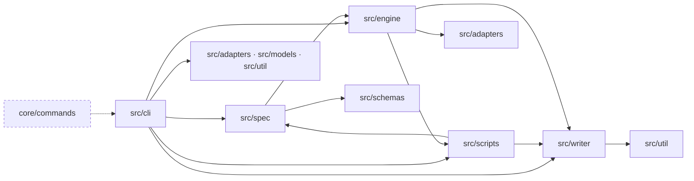

# Technical notes — One fixed layout for every spec folder

Spec folder layout version 2 is now published: one manifest per depth, a six-file committed log, the
whole close in `close-summary.md`, and a check that close enforces. A spec's version is its story's
`schema_version`. New specs start at 2, and every reader still handles version 1 as it is. MDO-0011
itself is a version 1 spec, so this close still writes `docs/releases/` and `docs/kaizen/`.

## What was built

| Task | Module | What | Commit |
|---|---|---|---|
| T1 | `src/spec/layout.ts`, `src/scripts/spec.ts`, `src/cli/run-spec.ts` | `layoutManifest(version, depth)` behind `mandao run layout`, the close gate and `docs/spec-anatomy.md`; `trace` and `acStatus` skip an AC with `status: removed` | `45e4033` |
| T2 | `src/scripts/spec-log.ts`, `src/spec/task-index.ts`, `core/` | Version 2 keeps tasks in `tasks.md` at every depth (`tasksHaveOwnFile`); the "3 or fewer inline" rule applies only to version 1; new stories start at `schema_version: 2` | `879fa53`, `a0c120a` |
| T3 | `src/spec/state.ts`, `src/spec/timeline.ts`, `src/spec/costs.ts` | `_log/state.yml` (start, baseline, progress, approvals, cut estimates) behind `logPath`; the approval timeline in `run status` and `implement-summary`; `cumulative` per role in version 2 | `630591c` |
| T4 | `src/scripts/spec-log.ts`, `src/writer/log-integrity.ts`, `src/engine/` | Six committed log files; packs, full gate output, probes, mutations, discrepancies and integrity hashes in the git-ignored `.mandao/cache/<ID>/`; the cache is dropped at close unless `logs.level: full` | `b63b0e5` |
| T4 (rework) | `src/spec/review-findings.ts` | `securityBlockers` counts only the `Findings` sections, so a rework PASS that recaps a fixed finding is not refused | `47b0c66` |
| T5 | `src/spec/close-summary.ts`, `core/commands/close.md` | Version 2 `close-summary.md` with Outcome, For the PO, For developers, Kaizen and Delivery; `docs/CHANGELOG.md` line; `docs/kaizen/lessons.md` | `dfea507` |
| T6 | `src/cli/run-ledger.ts`, `src/scripts/commits.ts` | `run close-summary --applied <path>`; `commit-spec <ID> close` stages recorded paths and the files regenerated from them, and names the rest in `leftOut` | `095b7e8` |
| T7 | `src/cli/run-diagram.ts` | `diagram-drift` on a lite spec returns `{ applicable: false, reason }` | `e640147` |

Module guides updated: `src/spec/AGENTS.md`, `src/writer/AGENTS.md`. New ADR:
[0041 — Spec folder layout version 2](../../decisions/0041-spec-folder-layout-v2.md).

## Decisions and pivots

- **D1:** the layout version is the story's `schema_version`, never a `layout:` key or the files present.
- **C-5:** migrating MDO-0008 to MDO-0010 left this spec. AC-7 is `removed`, and FR-7 and D8 are dropped.
- **T4 pivot:** untouched test files were dropped from `files:`, approved by the maintainer.
- **T4 security finding:** an unvalidated story id fed the cache delete. `specCacheDir` now throws on an id that is not a story id, so it never deletes outside the cache.
- **`47b0c66`:** the maintainer decided during T4 that only a review's current `Findings` block a PASS.

## Contract changes

- New command `mandao run layout <spec>`: `{ version, depth, stage, missing, unexpected, ok }`, exit 1 when not ok.
- `mandao run status <spec>` with no target prints `{ status, timeline }`. `run status <spec> closed` refuses a folder that does not match its layout.
- `mandao run close-summary --applied <path>` (repeatable). `commit-spec <ID> close` returns `leftOut`.
- `mandao run diagram-drift` returns `{ applicable: false, reason: "lite specs have no diagram" }` for lite specs, with exit 0.
- Config: `logs.level: summary | full` (default `summary`). Story `schema_version: 1 | 2`; any other value is an error.
- The managed `.gitignore` block adds `.mandao/cache/`.

## Diagram and drift

The approved diagram is `diagrams/proposed.mmd`. The built graph is
[`implemented.graph.json`](../../../specs/MDO-0011-one-fixed-layout-for-every-spec-folder/diagrams/implemented.graph.json),
derived by `diagram-drift`. It reports `drift: true`. None of its entries is a change in architecture:

- **Missing node `core/commands` and unverified edge `core/commands → src/cli`:** the command texts are Markdown, and the code graph indexes only code imports. They did change (T2, T5, T6). The edge is a rendering relation, not an import.
- **Added edges between code modules** (`src/cli → src/adapters, src/models, src/schemas, src/util, src/writer`; `src/engine → src/adapters, src/schemas, src/scripts, src/writer`; `src/spec → src/engine`; `src/scripts → src/schemas`; `src/writer → src/schemas, src/util`): these are imports the touched modules already had, which the proposed diagram left out to show only what changed. `src/spec → src/engine` is the existing `engine/frontmatter` helper (`architecture.md`). The spec added no new import between modules.
- **Edges to `.`:** `.` stands for root-level files the spec changed (README, `.gitignore`), not a module.
- **Unverified contract `mandao run layout`:** the code graph has no contract nodes. The command exists (`src/cli/run-spec.ts`) and is tested (`test/integration/layout.test.ts`).

## How to test

- `npx vitest run test/integration/layout.test.ts test/integration/lite-spec.test.ts test/integration/state-log.test.ts test/integration/log-v2.test.ts test/integration/log-v2-wide.test.ts test/integration/close.test.ts test/integration/close-commit.test.ts test/integration/close-drift.test.ts test/unit/layout.test.ts test/unit/content.test.ts`
- By hand: the [quickstart](../../../specs/MDO-0011-one-fixed-layout-for-every-spec-folder/quickstart.md). Use `node dist/cli.js` after `npm run build`: until this branch is merged, `.mandao/bin/mandao.mjs` runs main's build.

## Open items

- **Layout version 2 has not run on a real spec.** MDO-0012 will be the first, and the migration of MDO-0008 to MDO-0010 waits for it (backlog).
- **AC-1 is partial:** "the tasks step writes `tasks.md`" for a lite spec is an agent step. Tests pin the rendered command and the reader, and the first version 2 lite spec proves the rest.
- **`approve design` cannot clear a story change** that `next` reports ([Kaizen L3](../../kaizen/MDO-0011.md#l3)). Re-approving the story does clear it.
- **Tracker publication of a lite spec** (from the story, not critical): with no diagram, it would carry text only. There is no tracker today.

## Links

- Spec: [story](../../../specs/MDO-0011-one-fixed-layout-for-every-spec-folder/story.md), [requirements](../../../specs/MDO-0011-one-fixed-layout-for-every-spec-folder/requirements.md), [design](../../../specs/MDO-0011-one-fixed-layout-for-every-spec-folder/design.md), [verify report](../../../specs/MDO-0011-one-fixed-layout-for-every-spec-folder/verify-report.md)
- [Spec anatomy](../../spec-anatomy.md), [Kaizen](../../kaizen/MDO-0011.md), [release notes](release-notes.md)

## Evidence

- `node dist/cli.js run diagram-drift MDO-0011`: `missingNodes: [core/commands]`, 17 `addedEdges`, `missingEdges: []`,
  `unverifiedEdges: [core/commands -> src/cli]`, `unverifiedContracts: [mandao run layout]`, `relabelled: []`, `drift: true`.
- `node dist/cli.js run release-status MDO-0011`: AC-1 partial; AC-2 to AC-6 met.
- `git log main..HEAD` trailers: `Mandao-Task` T1 to T7 on the commits above.
