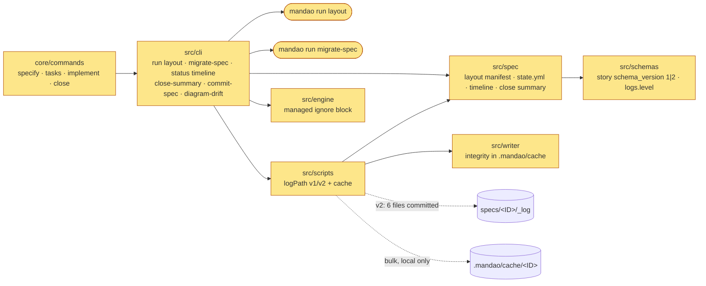

# Design — One fixed layout for every spec folder

One manifest in `src/spec/layout.ts`, keyed by layout version, depth and stage, drives the folder check,
the close gate and `docs/spec-anatomy.md`. `logPath` gains a version 2 resolution that maps the old log
files onto six files and the local cache. The close summary becomes a document with a record, not a
generated list of links. A one-shot `migrate-spec` moves MDO-0008 to MDO-0010 and refuses any move
that changes an answer.

## Decisions

### D1 — Layout version is the story's `schema_version`; one manifest drives check, gate and page

- **Why:**
  - Today nothing reads a spec's version, and "lite" means "`spec.md` exists" (`src/scripts/spec.ts:52`). A version field already exists in every story.
  - Bumping it to 2 marks new and migrated specs, and leaves 1 for the older ones.
  - `layoutManifest(version, depth)` returns the required files per stage and the allowed conditionals. `layoutFindings(folder)` is pure.
- **Depth:** read from `depth:` in `spec.md`, or in `requirements.md` / `design.md`. When the frontmatter has no `depth:`, it falls back to `lite` if `spec.md` exists.
- **Stages:** draft (story), specified (spec docs), planned (tasks), verified (verify-report), closed (close-summary). The stage is taken from the story status.
- **Rejected:**
  - A separate `layout:` frontmatter key, because it would be a second version number.
  - Inferring the version from the files present, because a broken version 2 folder would then pass as version 1.

### D2 — `tasks.md` always; the inline rule is removed for version 2

- **Code:**
  - `docPath('tasks')` stops falling back to `spec.md` when the story is version 2.
  - `MAX_INLINE_TASKS` and the `inline` option of `taskLayoutIssues` (`src/spec/task-index.ts:95-108`) apply only to version 1.
- **Content:**
  - `doc-lite.md`, `tasks.md:32`, `implement.md:15` and `specify.md:23` drop "3 tasks or fewer".
  - Lite `/mandao-specify` no longer writes tasks.
  - `/mandao-tasks` writes `tasks.md` at every depth.
- **Rejected:** keeping inline tasks for a single task, because the count rule is what the story removes.

### D3 — Version 2 log: six files, and `.mandao/cache/<ID>/` for the rest

`logPath(spec, file)` maps each logical log to its version 2 home. Callers keep their `LogFile` names.

| Logical log today | Version 2 home | Committed |
|---|---|---|
| `start.yml`, `baseline.md`, `progress.yml`, `approvals.yml`, `session-cuts.md` | `state.yml` (sections `start`, `baseline`, `progress`, `approvals`, `cut_estimates`; one zod schema) | yes |
| `execution.md`, `full-runs.md` | `execution.md`; full runs become a `## Full runs` section beside `## Forced runs`, so their reason stays committed (`forced.ts:79`) | yes |
| `reviews/Tn-k-review.md`, `Tn-k-<via>.md` | `reviews.md`, one `## Tn — attempt k` section each | yes |
| `gates/Tn-k.md` | `gates.md`, one section per attempt: the status table and, for failing gates only, at most 40 lines of output for the task's files | yes |
| `premises/Pn.md` | `premises.md`, one section per premise: claim, command, sha, exit, at most 20 lines | yes |
| `costs.yml` | `costs.yml`, `cumulative` per role only (C-2) | yes |
| `reviews/Tn-k-pack.md`, full gate output, `premises/probes/`, `premises/tmp/`, `mutations/`, `discrepancies.md`, `.integrity.json` | `.mandao/cache/<ID>/…` | no |

- **Why:**
  - Readers already go through `logPath` and `readSpec`, so the mapping is one module, with section-aware readers for the merged files.
  - P1 shows that nothing reads packs, mutations or discrepancies back. The review pack reads only the gates status table, which stays in `gates.md`.
  - P2 shows that the cache must sit outside the spec folder: the task commit stages the whole folder.
- **Gitignore:** `.mandao/cache/` joins the managed `.gitignore` block (`src/engine/graph.ts:40-57`).
- **Integrity:** the hashes in `.mandao/cache/<ID>/integrity.json` keep the checkpoint's edit detection. A hand edit is still recorded, as an `execution.md` note instead of `discrepancies.md`.
- **Cleanup:** close deletes `.mandao/cache/<ID>/` unless `logs.level: full` (a new config key, default `summary`).
- **Timeline (C-1):** `mandao run status <ID>` without `<to>`, and `implement-summary`, merge `state.yml` approvals into the execution rows by date. Nothing is written.
- **Rejected:**
  - One file per attempt in a committed `attempts/` folder, because it still grows with attempts.
  - Committing the packs compressed, because nobody reads them back.

### D4 — Version 1 stays readable through the same resolver

- `logPath` already resolves older specs at the root (`spec-log.ts:35`). Version 1 keeps today's mapping; version 2 uses D3.
- Every reader is tested on both layouts, as `spec-log.test.ts` already does for root versus `_log/`.
- **Rejected:** migrating MDO-0001 to MDO-0007, which is out of scope.

### D5 — `close-summary.md` is a document with a record

- **Shape:**
  - The frontmatter is the record: today's schema plus `applied: []`.
  - The body has `## Outcome`, `## For the PO`, `## For developers`, `## Kaizen`, `## Delivery`, from a new template `close/close-summary.md`.
- **Ownership:**
  - `run close-summary` owns the frontmatter, `Outcome` (from `release-status`) and `Delivery` (from the record). It rewrites only those two sections.
  - Close writes the prose sections from the existing kaizen, release-notes and technical templates, which become section guides.
- **Empty parts:** no field or section is written empty (S-4.3).
- **CHANGELOG:** `--closed` upserts one line per ID in `docs/CHANGELOG.md`: `| <ID> | <title> | <type> | <closed date> | [spec](../specs/<folder>/) |`.
- **Lessons:** approved Kaizen lessons append one line each to `docs/kaizen/lessons.md`.
- **Publish:** `publish-plan` reads `## For the PO` from `close-summary.md` for a version 2 spec, and `release-notes.md` for version 1.
- **Rejected:**
  - Keeping `docs/releases/<ID>/` as a copy, because each fact belongs in one document.
  - Generating the prose from code, because the notes need judgement.

### D6 — The close commit stages what close recorded, plus what was regenerated from it

- `run close-summary --applied <path>` records each approved edit outside the spec folder in `applied`.
- `closePaths` (`src/cli/run-ledger.ts:221-225`) returns:
  - the spec folder, `docs/CHANGELOG.md`, `docs/kaizen/lessons.md` and the constitution;
  - changed module guides;
  - `applied`;
  - every changed file listed in the lock, under `docs/commands/` or under `docs/diagrams/`.
- Every other uncommitted file is returned as `leftOut`.
- **Rejected:**
  - `git add -A`, because it would commit unrelated work.
  - Asking the agent for a path list at commit time, because it is not checkable.

### D7 — `diagram-drift` returns "not applicable" for lite

- `run-diagram.ts:105-106` returns `{ applicable: false, reason: "lite specs have no diagram" }` and exits 0 when the depth is lite.
- Standard and full keep the error when there is no stamp, and keep drift as today.
- **Rejected:** stamping a graph for lite specs (C-4).

### D8 — `migrate-spec` is a checked one-shot script

- **Steps:**
  1. Capture the JSON of `trace`, `kaizen`, `implement-summary` and `release-status`.
  2. Build the version 2 files in memory and run the same four readers on them, in a temporary copy.
  3. Write only when all four are equal and every verdict, cost entry, approval and task commit link is identical.
  4. Remove the version 1 files with `git rm`, and bump the story's `schema_version`.
- **Content:** gate outputs, packs and probes go to the cache. They stay in git history.
- **Commits:** one commit per spec.
- **Rejected:** a hand migration, because recorded values would be retyped.

## Changes by project and module

| Project | Module | Change | Exemplar file |
|---|---|---|---|
| mandao | Spec domain (`src/spec/`) | `layout.ts`: manifest and `layoutFindings` (D1); `state.ts`: the `state.yml` schema; timeline merge (C-1); `close-summary.ts`: sections, `applied` (D5); `task-index.ts`: inline rule only for v1 (D2) | `src/spec/next.ts`, `src/spec/close-summary.ts` |
| mandao | Scripts (`src/scripts/`) | `spec-log.ts`: v2 mapping and cache paths (D3, D4); `spec.ts`: version and depth (D1); `gates.ts`: the capped failing-only section; `publish.ts`: the `For the PO` source | `src/scripts/spec-log.ts` |
| mandao | CLI (`src/cli/`) | `run layout`; `run status <ID>` timeline; `run-ledger.ts` `closePaths` (D6); `run-close.ts` summary sections and CHANGELOG (D5); `run-diagram.ts` lite (D7); `run migrate-spec` (D8); writers of start, baseline, approvals, cuts, reviews, premises, mutations moved behind `logPath` | `src/cli/run-close.ts`, `src/cli/run-spec.ts` |
| mandao | Writer / Engine | `.integrity.json` path to the cache; `.mandao/cache/` in the managed `.gitignore` block | `src/writer/log-integrity.ts`, `src/engine/graph.ts` |
| mandao | Schemas | `story` `schema_version: 1 \| 2`; config `logs.level` | `src/schemas/story.ts`, `src/schemas/config.ts` |
| mandao | Content (`core/`) | `doc-lite.md`, `spec-docs.md`, `doc-close.md`; specify, tasks, implement, close commands; new template `close/close-summary.md`; story template `schema_version: 2` | `core/commands/close.md` |
| mandao | Docs | `docs/spec-anatomy.md` (from the manifest), README link, `docs/CHANGELOG.md`, `docs/kaizen/lessons.md`, ADR 0041 (spec folder layout v2) | `docs/decisions/0040-approval-by-running-the-next-command.md` |
| mandao | Specs | MDO-0008, MDO-0009, MDO-0010 migrated by `migrate-spec` (D8) | — |

## Diagram

<!-- mandao:diagram type=architecture tool=mermaid file=inline graph=diagrams/proposed.graph.json graphHash=sha256:d88bd03efbd355df source=sha256:4b0f32061d6a0edf -->
Derived from this design; regenerated whenever it changes. Part of the design approval.

## Contract

Single project; no cross-project contract.

## Risks and risk tags

- `migration`: the move of three closed specs (D8). It is guarded by the before/after comparison and lands as one commit per spec.
- `public-api`:
  - new `run layout`, `run migrate-spec` and `run status <ID>` without a target;
  - the `close-summary.md` shape and `state.yml`;
  - `diagram-drift` returning `applicable`.
  All other changes are additive, except the removal of `docs/releases` for version 2.
- **Critical flows**, whose suites must keep passing on both layouts:
  - "Script-owned logs record outside edits and preserve task commit evidence" (`ledger.test.ts`, `spec-log.test.ts`, `run-queue.test.ts`);
  - "Closure preserves publication identity and detects diagram drift" (`close.test.ts`);
  - "RED precedes implementation…" (`tdd.test.ts`, `enforced-rules.test.ts`, `review.test.ts`).
- **Tests pinning the old layout:**
  - `lite-spec.test.ts:132-136` (the "more than 3" message);
  - `mdo-0005-defects.test.ts:287-322` (the commit-spec close path list);
  - `spec-log.test.ts:92-99` (the releases link);
  - `release.test.ts:54-68`.
  They change for version 2 and keep a version 1 case.

## Constitution Impact

Proposals; /mandao-close applies them with approval.

- `critical-flows.md`: the "Script-owned logs…" row adds "the committed log of a version 2 spec is six files; the rest stays in the local cache" (`spec-log.test.ts`). The "Closure…" row adds "drift does not apply to lite specs; close commits what it recorded" (`close.test.ts`).
- `architecture.md`: the Spec domain owns the folder manifest (`layout.ts`). `.mandao/cache/` is local, never committed.
- `standards.md`: a spec's version is its story's `schema_version`; readers support every version still in the repo.

## Product Impact

- `product.md` capability map: "Checks every spec folder against one layout per depth", implemented.

## Module Docs Impact

- `src/spec/AGENTS.md`: `layout.ts` is the manifest; the version comes from the story; `state.yml` replaces five log files.
- `src/scripts/AGENTS.md` or the module index: `logPath` resolves v1 and v2, and the cache.

## Premise Ledger

### P1 — Nothing in `src/` reads Reviewer packs, mutation diffs or discrepancies back, and `docs/kaizen` / `docs/releases` are only written, linked and published (High)

- **If false:** moving them to the cache, or dropping `docs/kaizen/<ID>.md`, breaks a reader. D3 and D5 then need that reader changed first.
- **Evidence:** verified, `_log/premises/P1.md`, exit 0.
  - Every hit for packs, reviews, mutations and discrepancies is a writer.
  - The one read is `run-leader.ts:168`, which reads the gates file for the pack's status table, and that table stays in `gates.md`.
  - `docs/kaizen` and `paths.releases` appear only in `closePaths` (`run-ledger.ts:224`), `closeLinks` (`run-close.ts:172-173`), `notCode` (`:241`) and `publish-plan` (`:271`). D5 and D6 change all four.
  - `full-runs.md` is documented as read by Kaizen and the Reviewer (`forced.ts:79`), so D3 keeps it committed in `execution.md`.

### P2 — The task commit stages the whole spec folder, and `.mandao/cache/` is neither tracked nor ignored today (High)

- **If false:** the cache could live inside the spec folder, or would already be committed.
- **Evidence:** verified, `_log/premises/P2.md`, exit 0: "tracked under .mandao/cache: 0", "not ignored", and `commits.ts:138` adds the task's files plus `<specDir>`.

### P3 — Kaizen reads the session-cut estimates from the log, and the cross-spec cost baseline reads `cumulative` (High)

- **If false:** C-2 and C-3 would keep data nobody needs.
- **Evidence:** verified, `_log/premises/P3.md`, exit 0. `estimatesOf` reads `logPath(specDir, 'session-cuts.md')` (`session-turns.ts:240-250`, used at :277), and `newEntry(allEntries(ctx), o)` builds the record from every spec's entries (`run-cost.ts:136`), whose `cumulative` it writes (:110).

## Evidence

- `_log/premises/P1.md`, `P2.md`, `P3.md` (runs at `e0b45ab`, 2026-10-21); probes in `_log/premises/probes/`.
- Impact maps from the specify session: spec folder readers, `_log` writers and readers, close artifacts (file:line cited in the decisions).
